<div align="center">



</div>


<div align="center">

`C++` · `DSA` · `Problem Solving`


</div>
<p align="center">
  <a href="https://leetcode.com/u/_shubhishukla_/">
    
  </a>
  <a href="https://www.hackerrank.com/profile/2k25cse2514128">
    
  </a>
</p>


## `01 / about`

<div align="center">

</div>

```yaml
whoami:
  name: Shubhi Shukla
  role: CSE Student | DSA Enthusiast
  education: second-year student
  builds: PrepPath Placement Preparation Portal
  sharpening: C++ fundamentals, DSA, problem solving
  approach: learn by building, then improve the basics
  open_to: [internships, collaborations, project ideas]
```


## `02 / tech stack`

<div align="center">


</div>

## `03 / developer mindset`

```cpp
while (learning) {
    solveProblems();
    buildProjects();
    improve();
}
```

<div align="center">

**LOGIC OVER LUCK · CONSISTENCY OVER MOTIVATION**


</div>
